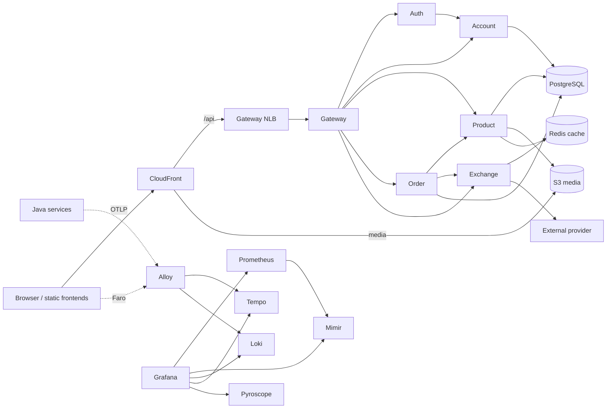

# Microsserv52

Microsserv52 is an educational microservices platform for browsing products and
creating demo orders. **This is a mock store: no real payments or transactions
take place, and no goods are shipped.**

[Read the platform documentation](https://microsserv52.github.io/platform/) ·
[Delivery evidence](https://github.com/Microsserv52/platform/blob/main/docs/project/delivery.md)

## Public demo

| Surface | URL |
| --- | --- |
| Landing | `https://d15ogksm4jp6sl.cloudfront.net/` |
| Store | `https://d15ogksm4jp6sl.cloudfront.net/store/` |
| Admin | `https://d15ogksm4jp6sl.cloudfront.net/admin/` |
| API | `https://d15ogksm4jp6sl.cloudfront.net/api` |
| API health | `https://d15ogksm4jp6sl.cloudfront.net/api/actuator/health` |

There is **no custom domain**. CloudFront's generated hostname is the public URL;
the Gateway NLB is an internal CloudFront origin. The steps to add Route 53, ACM
and a stable hostname are documented in
[Custom domains](https://github.com/Microsserv52/platform/blob/main/docs/infrastructure/custom-domains.md).

## Repositories

| Repository | Responsibility |
| --- | --- |
| [platform](https://github.com/Microsserv52/platform) | Integration, Compose/Kubernetes, Terraform, deployment and documentation |
| [gateway](https://github.com/Microsserv52/gateway) | API routing, browser sessions, JWT/CSRF and public access boundary |
| [auth](https://github.com/Microsserv52/auth) | Login and JWT issuance |
| [account](https://github.com/Microsserv52/account) | Registration, own profile and admin-restricted account reads |
| [order](https://github.com/Microsserv52/order) | Reusable Java Order API contract |
| [order-service](https://github.com/Microsserv52/order-service) | Demo order persistence, ownership and totals |
| [product](https://github.com/Microsserv52/product) | Product catalog, images and admin upload tickets |
| [product-interface](https://github.com/Microsserv52/product-interface) | Product OpenAPI and JSON schema contract |
| [exchange](https://github.com/Microsserv52/exchange) | Currency exchange provider and cache |
| [exchange-interface](https://github.com/Microsserv52/exchange-interface) | Exchange contract |
| [landing](https://github.com/Microsserv52/landing) | Public landing static export |
| [store](https://github.com/Microsserv52/store) | Catalog, cart, login and demo orders static export |
| [admin](https://github.com/Microsserv52/admin) | Admin catalog and accounts static export |

The platform checkout integrates the service and frontend repositories as Git
submodules. Product and Exchange are part of the current stack.

## Architecture



- **Backend:** Java 25/Spring Boot 4 services plus a Python FastAPI Exchange.
- **Frontend:** three independent Next.js/TypeScript static exports.
- **Data:** RDS PostgreSQL, ElastiCache Redis and private S3 buckets.
- **Delivery:** CloudFront for static sites, media and `/api`; Terraform NLB for
  the Gateway.
- **Observability:** self-hosted Prometheus, Mimir, Loki, Tempo, Pyroscope,
  Grafana, Alloy and blackbox. Java services use the OpenTelemetry agent; the
  frontends use Faro.
- **AWS edge:** Shield Standard, CloudFront OAC, security groups and an optional
  AWS WAF. WAF is prepared but not attached.

## Service observability requirements

Every service must expose health, Prometheus metrics and structured JSON logs,
and participate in OTLP tracing. Frontends must use Faro with privacy
redaction and an opt-out.

| Service | Metrics | Logs | Traces | Profiles |
| --- | --- | --- | --- | --- |
| Gateway | yes | yes | OTel Java | pending |
| Auth | yes | yes | OTel Java | pending |
| Account | yes | yes | OTel Java | pending |
| Order | yes | yes | OTel Java | pending |
| Product | yes | yes | OTel Java | pending |
| Exchange | yes | yes | pending Python integration | pending |
| Landing / Store / Admin | n/a | n/a | Faro locally; production URL pending | n/a |

The full endpoint, label, redaction, SLO and alert contract is in
[Service observability requirements](https://github.com/Microsserv52/platform/blob/main/docs/services/observability-requirements.md).
Service owners apply the Python/agent requirements in their own repositories;
the platform does not commit changes under `api/`.

## Local development

```bash
cp .env.example .env
docker compose up -d
```

Full local observability:

```bash
scripts/observability-up.sh
# Grafana    http://localhost:3000 (admin/admin)
# Prometheus http://localhost:9090
# Mimir      http://localhost:9009
# Loki       http://localhost:3100
# Tempo      http://localhost:3200
# Pyroscope  http://localhost:4040
```

The local frontends use `http://localhost:8080/faro/collect`; nginx forwards
`/faro/*` to the Alloy Faro receiver.

## Engineering and operations

- Java/Spring Boot, Docker Compose, Kubernetes, AWS EKS, Terraform and LocalStack.
- Unit/API/persistence/contract tests, CodeQL, frontend checks and immutable
  image publishing; deployment remains shell-first.
- Self-hosted observability with five Grafana dashboards, 13 recording rules and
  eight unified alert rules.
- Secrets stay out of source. Local values belong in `.env`; CI values in
  Actions secrets/variables. Grafana credentials are designed for AWS Secrets
  Manager; the live account does not have the observability stack yet.
- AWS observability manifests and Terraform are prepared but **not deployed**.
  The live account has no `observability` namespace; no WAF web ACL is attached.

## Documentation

| Page | Contents |
| --- | --- |
| [Delivery evidence](https://github.com/Microsserv52/platform/blob/main/docs/project/delivery.md) | Requirements, deployment, load and observability evidence |
| [Observability](https://github.com/Microsserv52/platform/blob/main/docs/operations/observability.md) | Local stack, dashboards, alerts, OTel and Faro |
| [Grafana on AWS](https://github.com/Microsserv52/platform/blob/main/docs/operations/grafana-aws.md) | EKS deployment, secrets and Cognito |
| [AWS edge security](https://github.com/Microsserv52/platform/blob/main/docs/infrastructure/aws-edge-security.md) | Shield, CloudFront, security groups and optional WAF |
| [AWS observability assessment](https://github.com/Microsserv52/platform/blob/main/docs/infrastructure/aws-observability-assessment.md) | Faro feasibility, WAF investigation and costs |
| [Custom domains](https://github.com/Microsserv52/platform/blob/main/docs/infrastructure/custom-domains.md) | What is missing and what to do |
| [Service contracts](https://github.com/Microsserv52/platform/blob/main/docs/services/contracts.md) | API and observability contracts |

The documentation site is published at
[microsserv52.github.io/platform](https://microsserv52.github.io/platform/).
